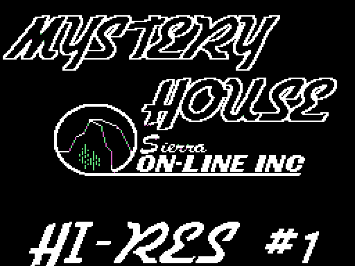
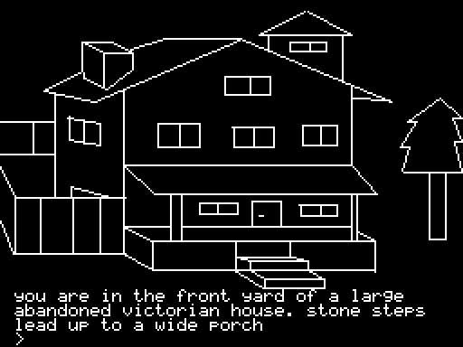

# Mystery House for the Sega SC-3000

A port of **Mystery House** (1980, Ken & Roberta Williams, On-Line Systems),
the first graphic adventure game, to the **Sega SC-3000** home computer.

 

- the pictures and the title screen of the Apple II original, drawn line by
  line like on the Apple II
- the texts in the wording of the Apple II original, 40 columns
- the game logic of the original, including its bugs
- title music: Saint-Saens, *Danse macabre*
- a 48 KB cartridge without mapper for the SC-3000 (2 KB RAM, keyboard);
  it also runs on the SD-1000 flash cart

## Playing

The ROM `mystery_house.SC` is built with `make` (see below). It runs on a real
SC-3000 from a 48 KB cartridge or the SD-1000 flash cart, and in emulators
with SC-3000 keyboard support, e.g. Emulicious or MAME (`sc3000`).

Type commands of one or two words, a verb and a noun: `open door`,
`get matches`, `go stairs`, `n` (north, south, east, west, up, down).
`look room` returns to the room view, `save game` / `restore game` keep the
game in RAM until the computer is switched off.
RETURN on an empty line toggles between the picture and the full screen text.
At `-more-` any key continues.

Stuck? See [WALKTHROUGH.md](WALKTHROUGH.md).

## Building

Requirements:

- [SDCC](https://sdcc.sourceforge.net/) 4.x with `sdasz80` (tested with 4.6.0)
- `ihx2sms` from [devkitSMS](https://github.com/sverx/devkitSMS) in the PATH
- Python 3 and GNU make; gcc for `make test`

```
make            # mystery_house.SC
make test       # plays the walkthrough on the PC (game logic, plain and packed texts)
make clean
```

The generated sources are checked in, so the steps below are only needed to
change data:

```
make data       # gamedata.c/.h, assets/assets.c, assets/texts.c from original/ and apple2/
python tools/make_music.py assets/midi/danse_macabre.mid --grid 2 --voice 10+0+11:top --voice 12+2+13:top --voice 15+14+8+3:bottom:12 --no-drums
```

`make_music.py` needs the Python package `mido`,
[midi2vgm](https://github.com/amoibos/midi2vgm) and `vgm2psg`/`psgcomp`
from PSGlib (devkitSMS); see its `--help`.

How the port works (memory layout, modules, picture format) is described in
[AGENTS.md](AGENTS.md).

Mystery House was released into the public domain by Sierra On-Line in 1987
to celebrate its 7th anniversary.
